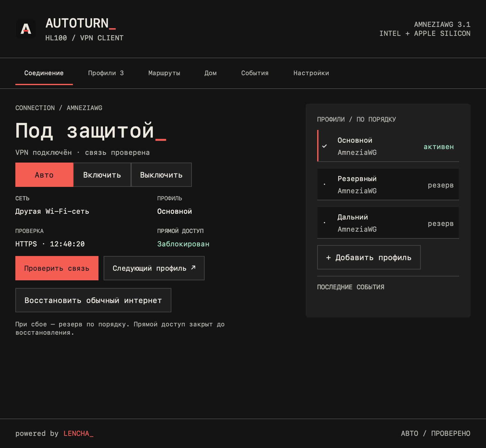
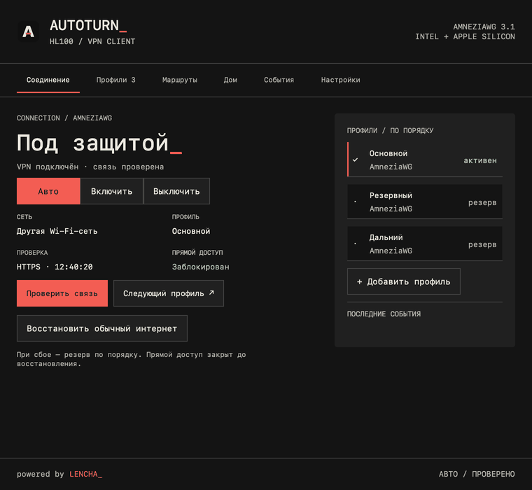
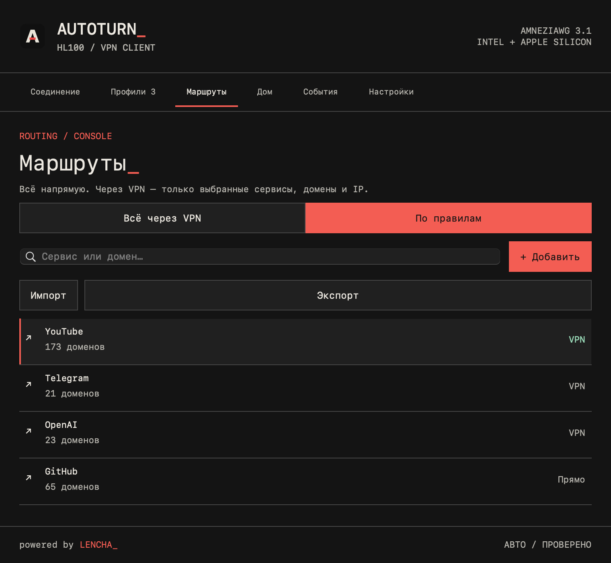
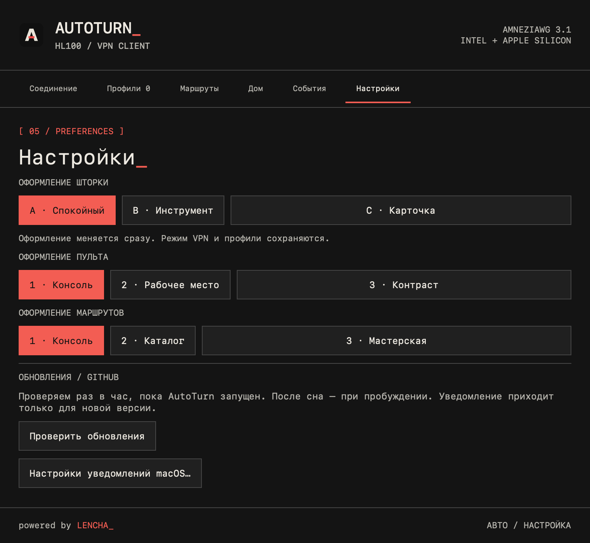

# AUTOTURN_

### Дома — напрямую. Вне дома — VPN.

Нативный AmneziaWG-клиент для macOS. Автоматизация домашней сети, выборочная маршрутизация и обновления прямо из приложения.

**[Скачать для macOS](https://github.com/cveloy102/autoturn-macos/releases/latest)** · **[Сайт](https://cveloy102.github.io/autoturn-macos/)** · **[Инструкция](docs/usage.md)** · **[Что нового в 1.0.4](releases/1.0.4/notes.md)**

**Обновление до 1.0.4 — вручную:** скачайте ZIP и замените только `AutoTurn.app` в «Программах». Старые версии не примут новый ключ обновления. Профили, домашние сети и имеющиеся правила сохраняются отдельно от приложения; данные удалять не нужно. [Подробности перехода](releases/1.0.4/notes.md).

*Скриншоты с демонстрационными профилями. powered by LENCHA_.*

## Посмотрите, как устроен AutoTurn

*Анимированный обзор реальных экранов с демонстрационными данными.*

## Один пульт для повседневного VPN

AutoTurn живёт в верхнем меню macOS. Задайте домашние Wi-Fi и импортируйте профиль: в режиме «Авто» дома интернет идёт напрямую, вне дома включается VPN. Ручные режимы доступны в любой момент.

| Возможность | Как это работает |
| --- | --- |
| Домашняя сеть | Список доверенных Wi-Fi и автоматическое переключение |
| AmneziaWG 3.1 | Импорт `.conf`, несколько профилей и резерв по порядку |
| Маршруты | Весь интернет через VPN или только выбранные сервисы, домены и IP |
| Каталог сервисов | Поиск, множественный выбор и обновляемые списки GeoAggregator |
| Свои правила | IP-списки, HydraRoute, HTTPS-источники и перенос JSON |
| Восстановление | Контроль компонентов и восстановление сети после сбоя |
| Приватные профили | Хранение в Связке ключей macOS |
| Обновления | Проверка раз в час, уведомление и установка по вашему действию |

## Установка за несколько шагов

1. [Скачайте ZIP из последнего релиза](https://github.com/cveloy102/autoturn-macos/releases/latest), распакуйте и перенесите `AutoTurn.app` в «Программы».
2. Откройте приложение. Если macOS блокирует запуск, разрешите **AutoTurn** в «Системные настройки → Конфиденциальность и безопасность» и повторите запуск.
3. Импортируйте профиль **AmneziaWG `.conf`** кнопкой или перетаскиванием.
4. Мастер сам проверит службу и при необходимости начнёт установку. Подтвердите системный запрос администратора macOS.
5. Разрешите определение имени Wi-Fi, добавьте домашнюю сеть и выберите **«Авто»**.

Требуется **macOS 13 или новее**. Один архив для Intel и Apple Silicon, без Rosetta. Приложение подписано ad hoc; Developer ID и нотариализации пока нет. Отключать защиту macOS целиком не требуется. AutoTurn использует ваш VPN-сервер и не предоставляет подписку или сервер.

## Через VPN — то, что нужно вам

Включите весь туннель или выберите сервисы и собственные домены/IP. В выборочном режиме остальные направления идут напрямую. При отказе туннеля VPN-направления остаются заблокированными. Каталог можно обновлять, а пользовательские правила — сохранять и переносить.

[Настройка маршрутов и импорт списков →](docs/usage.md#маршрутизация)

## Пульт под ваш стиль

Три оформления пульта, три оформления верхнего меню и три оформления маршрутов. Закрытие окна оставляет приложение работать в меню.

## Обновление с предыдущего релиза

В пульте нажмите **«Проверить обновления»**. Когда появится новая версия, запустите установку. Установщик сохраняет профили и настройки, обновляет приложение и службу, затем перезапускает AutoTurn. macOS может повторно запросить доступ к Связке ключей.

Метаданные и архив проверяются Ed25519, SHA-256, подписью bundle и наличием четырёх универсальных компонентов. Закрытый ключ выпуска хранится вне репозитория и GitHub.

**[Изменения 0.1.9 → 1.0.0](releases/1.0.0/notes.md)** · [История релизов](https://github.com/cveloy102/autoturn-macos/releases)

## Документация и обратная связь

[Использование и FAQ](docs/usage.md) · [Сборка и выпуск](DEVELOPMENT.md) · [Проверки перед 1.0](AUDIT-2026-10-12.md) · [Сообщить об ошибке](https://github.com/cveloy102/autoturn-macos/issues/new)

При описании ошибки укажите версию macOS, архитектуру, версию AutoTurn, режим и шаги воспроизведения. Не прикладывайте приватные ключи и полный VPN-профиль.

Работа реального VPN проверена на Intel; CI запускает универсальные компоненты нативно на Intel и Apple Silicon. Сценарии с вашим сервером, домашним Wi-Fi и сторонним VPN нужно проверить в вашем окружении. IPv6-only внешняя сеть и IPv6 Endpoint пока не поддерживаются.

Проект использует [amneziawg-go](https://github.com/amnezia-vpn/amneziawg-go) и модифицированный [sing-box](https://github.com/SagerNet/sing-box). Лицензии входят в приложение; соответствующие исходники и инструкции сборки прилагаются к релизу.

[AutoTurn для Android](https://github.com/cveloy102/autoturn-vpn) — отдельный проект с отдельным каналом обновлений.
